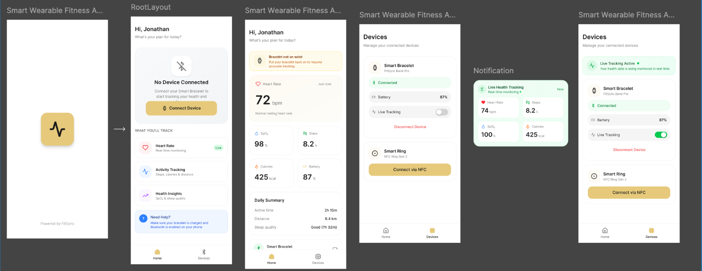
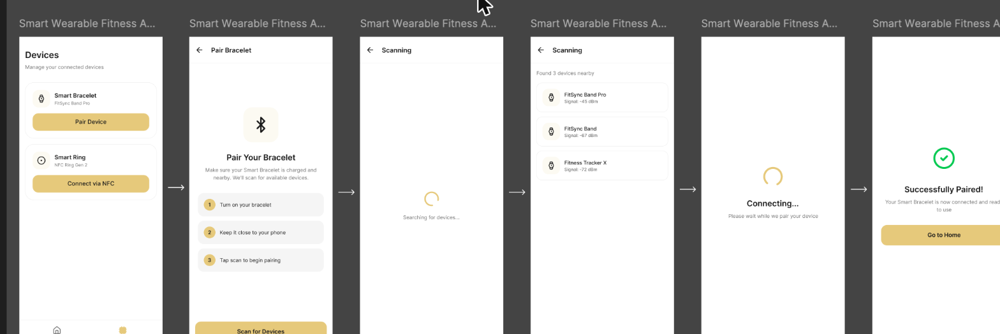

# Smart Jewelry App

An Android companion app for a **smart bracelet**. The bracelet runs custom ESP32-C3 firmware, measures **heart rate and blood-oxygen saturation (SpO₂)**, and sends the readings to the phone over **Bluetooth Low Energy (BLE)** in real time.

> The bracelet firmware lives in a separate repo: **[Smart-Bracelet-Embedded-System](https://github.com/Hamed-mohamed-Git/Smart-Bracelet-Embedded-System)**


---

## Table of contents

- [How it works](#how-it-works)
- [Features](#features)
- [UI design](#ui-design)
- [Architecture](#architecture)
- [BLE protocol](#ble-protocol)
- [Getting started](#getting-started)
- [Project structure](#project-structure)
- [Roadmap](#roadmap)

---

## How it works

```
┌──────────────────────────┐        BLE notify (JSON)        ┌──────────────────────────┐
│  Smart Bracelet          │  ─────────────────────────────▶ │  Smart Jewelry App       │
│  ESP32-C3 + MAX30102     │   {"hr":72,"spo2":98,...}       │  Android · Kotlin        │
│  NimBLE GATT server      │                                  │  BLE GATT client         │
└──────────────────────────┘                                  └──────────────────────────┘
```

1. The bracelet advertises a custom GATT service.
2. The app scans, finds the bracelet, and connects over GATT (`TRANSPORT_LE`).
3. The app discovers services and enables notifications by writing the CCCD descriptor.
4. Every few seconds the bracelet pushes a JSON payload with the latest heart-rate and SpO₂ reading.

## Features

**Implemented**

- Full BLE session pipeline: **scan → connect → discover services → subscribe to notifications**
- The session is a single Kotlin `Flow` (`callbackFlow`). Cancelling the collector stops the scan and closes the GATT connection.
- Observable `ConnectionState` (`Idle`, `Scanning`, `Connecting`, `DiscoveringServices`, `Ready`, `Disconnected`, `Error`) exposed as a `StateFlow`
- 15-second scan timeout with a clear error state
- Runtime permission handling for Android 12+ (`BLUETOOTH_SCAN`, `BLUETOOTH_CONNECT`) and for older versions (`ACCESS_FINE_LOCATION`)
- GATT callbacks for both API 33+ (`onCharacteristicChanged(value)`) and older devices
- Human-readable mapping of scan, GATT-status and connection-state error codes
- Dependency injection with **Koin** annotations and the compiler plugin

**In progress:** the Jetpack Compose UI shown below

## UI design

The UI is designed in Figma (*Smart Wearable Fitness*). It covers the home dashboard, device management, live-tracking notifications, and the pairing flows for the bracelet (BLE) and the ring (NFC).

**App screens:** splash, empty state, live dashboard, devices, notification



**Pair bracelet flow:** devices, instructions, scanning, device list, connecting, success



| Screen | What it shows |
|---|---|
| **Home: no device** | Empty state with a *Connect Device* call to action and a list of tracked metrics |
| **Home: dashboard** | Live heart rate (bpm), SpO₂ %, steps, calories, battery, a daily summary (active time, distance, sleep quality), and an off-wrist warning |
| **Devices** | Smart Bracelet (BLE) with connection status, battery and a *Live Tracking* toggle. Smart Ring (NFC) |
| **Notification** | Live health tracking card with heart rate, steps, SpO₂ and calories |
| **Pair Bracelet** | Step-by-step guide, then scanning, a list of nearby devices with signal strength (dBm), connecting, and *Successfully Paired!* |

## Architecture

```
MainActivity
  │  requests BLE permissions, collects the session and the connection state
  ▼
BleManager  (@Singleton, injected by Koin)
  ├── session(): Flow<BleEvent>          ← callbackFlow wrapping the scanner + GATT
  ├── connectionState: StateFlow<ConnectionState>
  │
  ├── GattCallbackFactory                ← API 33+ and legacy callbacks, shared handlers
  ├── BleEvent                           ← DeviceFound · ServicesDiscovered · NotificationReceived · ScanFailed
  ├── ConnectionState                    ← sealed state model
  └── BleErrorMapper                     ← readable scan, GATT and connection errors
```

**Tech stack:** Kotlin 2.3 · Jetpack Compose (Material 3) · Coroutines and Flow · Koin 4.2 (annotations and compiler plugin) · Android BLE APIs · Gradle Kotlin DSL with a version catalog

## BLE protocol

| Item | Value |
|---|---|
| Service UUID | `12345678-1234-1234-1234-1234567890ab` |
| Characteristic UUID | `abcdefab-1234-1234-1234-abcdefabcdef` (READ, NOTIFY) |
| CCCD | `00002902-0000-1000-8000-00805f9b34fb` |
| Initial value | `{"status":"waiting"}` |

**Notification payload** (UTF-8 JSON):

```json
{ "hr": 72, "spo2": 98, "validHr": 1, "validSpo2": 1 }
```

| Field | Meaning |
|---|---|
| `hr` | Heart rate in beats per minute |
| `spo2` | Blood-oxygen saturation in % |
| `validHr` / `validSpo2` | `1` if the algorithm produced a valid reading, `0` otherwise |

## Getting started

**Requirements**

- Android Studio (a recent version that supports AGP 9.1)
- A physical Android device with Bluetooth LE (the emulator has no BLE). Android 7.0 (API 24) or newer.
- A bracelet flashed with the [firmware](https://github.com/Hamed-mohamed-Git/Smart-Bracelet-Embedded-System)

**Steps**

```bash
git clone https://github.com/Hamed-mohamed-Git/Smart-Jewelry-App.git
cd Smart-Jewelry-App
./gradlew installDebug
```

**Point the app at your bracelet.** The target device is set in `BleManager.kt`:

```kotlin
private const val TARGET_DEVICE_NAME = "MyMicrocontroller"
private const val TARGET_DEVICE_MAC  = "10:00:3b:d0:d3:c2"
```

When `TARGET_DEVICE_MAC` is set, the app matches by MAC address. When it is blank, the app matches by name. The firmware prints its MAC address to the serial monitor at boot (`ESP32 BLE MAC: ...`). Use that MAC, or clear the MAC and set the name to the firmware's `DEVICE_NAME`.

**Watch the data.** Until the UI lands, everything is logged under the `SmartJewelry` tag:

```bash
adb logcat -s SmartJewelry
```

## Project structure

```
app/src/main/java/com/smart/jewelry/app/
├── MainActivity.kt            # permissions, BLE session collection
├── SmartJewelryApp.kt         # Application class, starts Koin
├── ble/
│   ├── BleManager.kt          # scan → connect → subscribe as a Flow
│   ├── GattCallbackFactory.kt # GATT callbacks, enabling notifications
│   ├── BleEvent.kt            # events emitted by the session
│   ├── ConnectionState.kt     # connection state machine
│   └── BleErrorMapper.kt      # error-code → readable string
└── ui/theme/                  # Compose theme (colors, typography)
```

## Roadmap

- [ ] Compose screens from the Figma design (home dashboard, devices, pairing flow)
- [ ] Parse the JSON payload into a typed `PulseReading` model and expose it through a ViewModel
- [ ] Device picker based on scan results instead of a hard-coded MAC address
- [ ] Automatic reconnection and a foreground service for background tracking
- [ ] Smart Ring pairing over NFC
- [ ] Unit tests for the state machine and payload parsing
